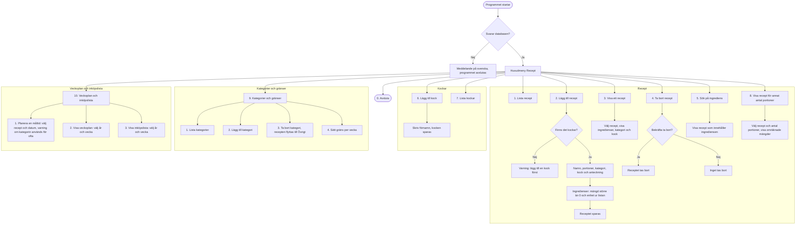
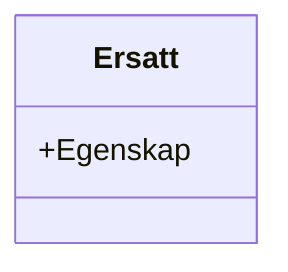

# Inlämning 2: Grupparbete

> Projektnamn: [ändra till ert projektnamn]

---

## Börja här

Det här repot innehåller tolv projektmallar: fyra projekt (Hushållsbudget, Träningsbok, Sportstatistik, Recept) i tre gränssnitt (konsol, MVC, Blazor). Ni använder **en**.

1. **Forka repot.** Klicka på **Fork** uppe till höger på repots GitHub-sida, och välj ert eget konto. **Reponamnet måste innehålla gruppens namn** (samma som i `GRUPP.md`), till exempel `grupp-kodkrigarna-clo26-inlamning-2-start`. Ändra namnet i fork-dialogen eller under **Settings** innan ni klonar.
2. **Klona er fork** (inte originalrepot): `git clone https://github.com/<ert-användarnamn>/<repo-namn>.git`. Välj sedan ett projekt och ett gränssnitt, och radera de elva andra mapparna och deras rader i `Projekt.slnx`. Kör `dotnet build Projekt.slnx`. Finns det kvar rader för borttagna mappar går bygget sönder. Committa och pusha ändringarna till **er fork**.
3. **Bjud in dina gruppkollegor och `marcusjobb`** som medarbetare: **Settings → Collaborators → Add people**.
4. **Sätt upp en kanban** i Trello eller GitHub Projects. Bjud in `marcusjobb` så att läraren ser den.
5. **Fyll i `GRUPP.md`**: gruppnamn, medlemmar, valt projekt, valt databas, kanban-länk och era gruppregler.
6. **Bygg och kör:** `dotnet build`, sedan `dotnet run --project <ert projekt>`.
7. **Kontrollera innan inlämning:** gå igenom [GATES.md](GATES.md) och kör [KODKONTROLL_PROMPT.md](KODKONTROLL_PROMPT.md) mot er kod.
8. **Lämna in:** ladda ner zippen från er fork (**Code → Download ZIP**, på branchen `main`), och lämna in den på Classroom. En zip per grupp, och filen heter som er fork, till exempel `grupp-kodkrigarna-clo26-inlamning-2-start.zip`.

**Reflektionen** skriver ni var för sig, i en egen fil som heter `<förnamn>-reflektion.md` (till exempel `marcus-reflektion.md`), och lämnar in den privat på Classroom. Namn, grupp och projekt står överst i filen. Den ligger inte i repot.

**AI-stöd.** Kodkontrollen är en prompt som ni kör mot er egen kod: [KODKONTROLL_PROMPT.md](KODKONTROLL_PROMPT.md). Att köra den räknas som AI-stöd, och ska deklareras i README:n.

**Testning och granskning** loggas i `peer_review_log.md`. Allt som krånglar, glitchar eller buggar loggas där, med hur det lösts.

**README:n skriver ni själva.** Mallen är ett skelett. AI får användas, men det ska deklareras. Att köra kodkontrollen räknas också som AI-stöd.

**Anpassa README:n till er presentation av projektet.** Skriv om den så att den beskriver ert projekt och era val, och inte står samma sak som mallen. Ta bort alla hakparenteser, instruktionstexter och kommentarer som bara hör till mallen.

**Git:** gör varje commit med er egen identitet (`git config user.name` och `user.email`). Använd gärna GitHubs noreply-adress som e-post, så att er privata adress inte syns. Skriv inte om historiken (inga force-push eller squash på `main`). Läraren läser bidrag ur git-historiken.

**Er fork kan vara publik.** Lägg aldrig hemligheter eller personuppgifter i repot.

Koden ska följa Clean Code, DRY, SRP och SoC. Namn på klasser, metoder, variabler och tabeller är på engelska, men utskrifter och kommentarer är på svenska. Ingen connectionstring i koden. Minst tre commits.

---

## Så kör du projektet

### Databas

Ni väljer databas själva: SQLite, MySQL, SQL Server, PostgreSQL, MongoDB eller en minnesdatabas. Motivera valet i reflektionen. Läraren kör er kod mot en egen, tom databas, så er kod måste bygga och seeda allt själv.

**A. SQLite (en fil, ingen server).** Enklast att komma igång med:
```bash
dotnet add package Microsoft.EntityFrameworkCore.Sqlite
```
Connectionstringen blir till exempel `Data Source=projekt.db`. Använd en **relativ** sökväg, inte `C:\...`.

**B. MongoDB lokalt med Docker** (kräver Docker Desktop eller Docker Engine):
```bash
docker run -d -p 27017:27017 --name mongo mongo:latest
dotnet add package MongoDB.Driver
```
Connectionstringen blir `mongodb://localhost:27017`.

**C. MongoDB Atlas i molnet** (gratis konto, ingen installation):
1. Skapa ett konto på [mongodb.com/atlas](https://www.mongodb.com/cloud/atlas/register).
2. Skapa ett gratiskluster (M0). Välj närmaste region.
3. Under **Database Access**: skapa en databasanvändare med ett eget lösenord. Spara lösenordet.
4. Under **Network Access**: lägg till er egen IP-adress (**Add Current IP Address**).
5. Under **Database → Connect → Drivers**: kopiera connectionstringen. Den börjar med `mongodb+srv://`. Byt ut `<password>` mot ert lösenord.
6. Installera drivrutinen: `dotnet add package MongoDB.Driver`.

Atlas gränssnitt ändras ibland, så gå efter de rubriker som finns där.

**D. MySQL med Docker:**
```bash
docker run -d --name mysql -e MYSQL_ROOT_PASSWORD=<ert lösenord> -p 3306:3306 mysql:8
dotnet add package Pomelo.EntityFrameworkCore.MySql
```
Connectionstringen blir till exempel `server=localhost;port=3306;user=root;password=<ert lösenord>;database=projekt`.

**E. PostgreSQL med Docker:**
```bash
docker run -d --name postgres -e POSTGRES_PASSWORD=<ert lösenord> -p 5432:5432 postgres:16
dotnet add package Npgsql.EntityFrameworkCore.PostgreSQL
```
Connectionstringen blir till exempel `Host=localhost;Port=5432;Username=postgres;Password=<ert lösenord>;Database=projekt`.

**F. SQL Server med Docker:**
```bash
docker run -d --name sqlserver -e ACCEPT_EULA=Y -e MSSQL_SA_PASSWORD=<ett starkt lösenord> -p 1433:1433 mcr.microsoft.com/mssql/server:2022-latest
dotnet add package Microsoft.EntityFrameworkCore.SqlServer
```
Connectionstringen blir till exempel `Server=localhost,1433;User Id=sa;Password=<ett starkt lösenord>;TrustServerCertificate=True;Database=projekt`.

**G. Minnesdatabas (EF Core InMemory).** Data försvinner när programmet stängs, så programmet bygger och seedar vid varje start:
```bash
dotnet add package Microsoft.EntityFrameworkCore.InMemory
```

Lösenorden ovan är platshållare. Lägg dem aldrig i koden eller i repot, bara i user-secrets.

### Connectionstring (user-secrets)

Connectionstringen ligger aldrig i koden, aldrig i repot och aldrig i zippen. Den sparas i en secrets-fil på er dator:

```bash
dotnet user-secrets init --project <ert projekt>
dotnet user-secrets set "DB_CONNECTION" "<er connectionstring>" --project <ert projekt>
```

Läraren kör er kod mot sin egen Docker-server och sätter connectionstringen själv. Ni lämnar ingen connectionstring. Er kod måste därför bygga och seeda hela databasen själv vid första start.

### Starta programmet

```bash
dotnet run --project <ert projekt, till exempel Hushallsbudget>
```

Vid första start skapar programmet databasen och lägger in exempeldata, om databasen är tom.

---

## Upplägg

- **Gränssnitt:** [konsol / Blazor / MVC]
- **Databas:** [SQLite / MySQL / SQL Server / PostgreSQL / MongoDB / minnesdatabas]
- **App:** [kort beskrivning]

## Gränssnittsplan

Programmet är ett konsolprogram med en huvudmeny och två "undermenyer". Varje val körs, och sedan visas menyn igen tills användaren väljer 0. Om något går fel inne i ett val (till exempel ogiltig inmatning) visar menyn ett meddelande och programmet fortsätter.



Kort förklaring: huvudmenyn visar alla funktioner. Val 2 kräver minst en kock, eftersom varje recept har en kock (beslut 4). Mängd och enhet kontrolleras av `RecipeBuilder`. Val 9 och 10 öppnar egna undermenyer, och 0 i en undermeny går tillbaka till huvudmenyn.

## UML-klassdiagram

<!-- Ersätt klassen Ersatt med era egna klasser och relationer. Mermaid behöver minst en klass för att rendera. -->


Kort förklaring: [vad är klass, vad är relation, varför ser det ut så här?]

## Refactoring-logg

Minst tre förbättringar i er egen kod, före och efter:

### 1. [Vad ändrade ni?]

- **Problem:**
- **Före:**
- **Efter:**
- **Varför blev det bättre?**

### 2. [...]

### 3. [...]

## Fält och data

Gå igenom varje fält i datamodellen. Behåll de fält programmet behöver och ta bort resten, både ur koden och ur databasen. Motivera varje fält, oavsett om ni behåller eller tar bort det.

| Entitet | Fält | Behålls / tas bort | Motivering |
|---------|------|--------------------|------------|
| | | | |

## Designmönster

| Mönster | Var i koden | Varför |
|---------|-------------|--------|
| | | |

Mönster ni valt bort: [ange vilka och varför]

## Granskning

- Granskningsnotis: [GRANSKNINGSNOTIS.md](GRANSKNINGSNOTIS.md)

## AI-deklaration

AI-stöd ska deklareras. Fyll i tabellen, och skriv vad ni själva granskat och ändrat.

| Verktyg | Vad användes det till | Vilka filer / delar | Vad ändrades efter granskning |
|---------|-----------------------|---------------------|-------------------------------|
| | | | |

Om ni inte använt AI: skriv "Ingen AI användes".

## Tekniker

- C# / .NET 10
- [Lägg till de paket ni använt]
